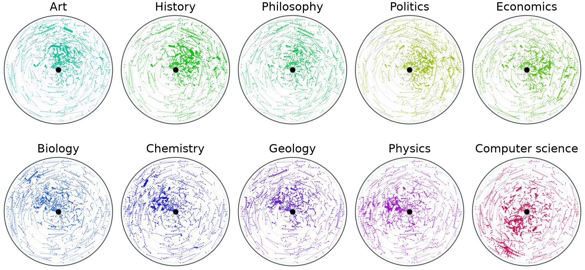
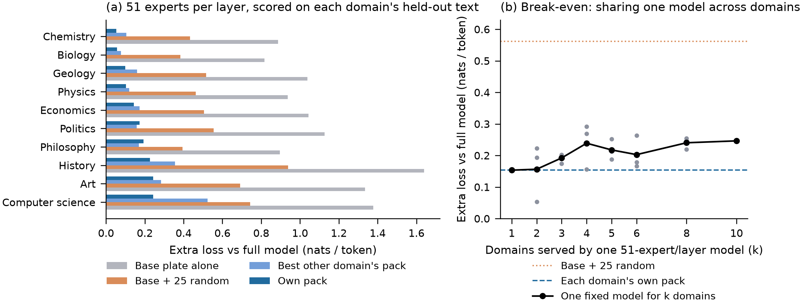

# Edge-MoE: expert packs for a mixture-of-experts model

<p align="center">

</p>

**Every subject has a routing fingerprint inside a mixture-of-experts model, and you can cut the model down to the experts a subject uses, keep the routers, and still run it in stock llama.cpp.**

Edge-MoE maps which of Gemma 4 26B-A4B's 3,840 experts each subject's text is routed to, and uses that map to build an *expert pack*: the shared core of the model plus only the experts one subject needs. The routers are sliced to match, so the pack is a valid, smaller Gemma 4 model. Nothing is retrained.

**[Explore the interactive domain maps →](https://toastydoc.github.io/Edge-MoE/viz/domain_maps.html)** Every subject's routing fingerprint, drawn layer by layer, and what keeping only those experts costs.

## 1. Every subject has a routing fingerprint

The router sends a subject's text to a consistent, recognisable set of experts. Ten subjects were built from Wikipedia article introductions (art, history, biology, geology, politics, computer science, economics, chemistry, physics, philosophy): five categories per subject, articles found under two subjects dropped from both, then split by article into 249–300 profiling articles and 83–100 held-out test articles per subject. One source for all ten keeps the comparison about topic, not writing style.

**The fingerprint is stable.** A pack chosen from one half of a subject's profiling articles shares 86% of its experts (Jaccard) with the pack chosen from the other half, against 50% with other subjects' packs. Computer science is the most distinct (41% overlap with the rest).



*Each map: router at the centre, the 30 layers as rings, every ring's 128 experts in evenly spaced slots placed by which subjects favour them. Coloured: the subject's 25-expert pack per layer; grey: the shared core. Line weight and dot size follow the expert's share of that layer's routing.*

**The fingerprint predicts which experts held-out text needs.** Loss is next-token cross-entropy on the held-out introductions, scored as the model's reply to *"Write the Wikipedia introduction for the article <title>"* (Gemma 4 instruct degenerates on bare text outside a chat turn). Extra loss over the full 128-expert model, nats per token, all at 51 experts per layer:

| Subject | Full model | Shared core alone | Shared core + 25 random | **Own pack** | Best other pack |
|---|---|---|---|---|---|
| art | 3.37 | +1.33 | +0.69 | **+0.24** | history +0.29 |
| history | 3.05 | +1.64 | +0.94 | **+0.23** | art +0.36 |
| biology | 3.15 | +0.82 | +0.38 | **+0.06** | chemistry +0.08 |
| geology | 3.18 | +1.04 | +0.52 | **+0.10** | biology +0.16 |
| politics | 3.21 | +1.13 | +0.55 | +0.17 | **history +0.16** |
| computer science | 3.18 | +1.38 | +0.74 | **+0.24** | physics +0.52 |
| economics | 3.14 | +1.04 | +0.51 | **+0.14** | politics +0.17 |
| chemistry | 3.06 | +0.89 | +0.43 | **+0.05** | geology +0.11 |
| physics | 2.96 | +0.94 | +0.46 | **+0.10** | chemistry +0.12 |
| philosophy | 3.29 | +0.90 | +0.40 | +0.19 | **history +0.17** |
| **mean** | 3.16 | +1.11 | +0.56 | **+0.15** | +0.21 |

The own pack recovers 86% of the gap between the shared core and the full model; random experts recover 49%. Packs act more like neighbourhoods than single subjects: related subjects swap well (chemistry's pack serves biology almost as well as biology's), and the history pack beat the politics and philosophy packs on their own text. Loss measures surprise at real text, not answer quality, and it understates what a small pack loses; the blind-judged answers [below](#2-keep-the-routers-drop-the-experts-it-still-runs) are the measure that counts.



**Subjects can share a pack.** Shared core plus the experts k subjects use most, still 51 per layer, scored on its own k subjects (3 random subject sets per k, 1 for k = 10):

| Subjects served | 1 (own pack) | 2 | 3 | 4 | 5 | 6 | 8 | 10 |
|---|---|---|---|---|---|---|---|---|
| Extra loss (nats/token) | +0.153 | +0.156 | +0.192 | +0.239 | +0.218 | +0.203 | +0.240 | +0.246 |
| Share of the pack's gain over random kept | 100% | 99% | 91% | 79% | 84% | 88% | 79% | 77% |

Two subjects share 51 slots at no measurable cost. From four on, the curve levels off near 80% instead of falling toward random: one shared pack for all ten keeps about three quarters of a dedicated pack's gain.

**What the router's choice tracks.** A token pass (`scripts/profile_expert_tokens.py`, 900 prompts over 15 subjects) recorded which tokens each expert receives. In layers 1–2 and the last three layers, token type (numbers, punctuation, word starts) explains more of the choice of expert than the subject does; in layers 3–27 the subject explains more. Neither explains most of it. So the fingerprint lives mainly in the middle of the network.

**See it yourself.** The [interactive domain maps](https://toastydoc.github.io/Edge-MoE/viz/domain_maps.html) draw each subject's experts the same way: switch between the full model (every expert the subject's text reaches) and the pack, select up to three subjects to see them share one pack, and hover an expert to see its routing share and the tokens it receives.

## 2. Keep the routers, drop the experts: it still runs

1. **Profile.** Run a subject's text through the model and count which experts the router picks in each of the 30 layers.
2. **Keep the shared core plus the subject's pack.** Everything that is not an expert (attention, embeddings, routers), the experts general text uses most, and the subject's most used experts on top, up to N of 128 experts per layer.
3. **Slice the routers to match.** The router takes a softmax over all experts, keeps the top 8 and renormalises them, so dropping the rows of experts that are not kept gives exactly the same choices and weights as masking them. The export script checks this on all 30 layers before writing.

The result is an ordinary Gemma 4 checkpoint with fewer experts per layer. llama.cpp's own converter turns it into a GGUF and stock llama.cpp (b12549, unmodified) runs it:

| Model | Experts per layer | File (GGUF) | RTX 5080 | Ryzen 7 9700X, no GPU |
|---|---|---|---|---|
| Full Gemma 4 26B-A4B, Q4_K_M | 128 | 16.8 GB | — | — |
| Full model, Q3_K_M | 128 | 13.3 GB | 223 tok/s | 20.0 tok/s |
| Full model, Q2_K | 128 | 10.6 GB | degenerate output on all 300 test questions | |
| **Subject pack, Q4_K_M** | 64 | **9.2 GB** | 200 tok/s | 17.5 tok/s |
| **Subject pack, Q3_K_M** | 64 | **7.4 GB** | 225 tok/s | 20.5 tok/s |

Squeezing the full model to 10.6 GB with standard quantisation breaks it; dropping half the experts and keeping the routers gives a working model at 7.4 GB.

**What it costs.** A pack answers its own subject well and other subjects poorly. Against the full 26B on 300 blind-judged questions from held-out Wikipedia articles (each subject's questions to that subject's pack; Gemini 3.1 Pro judging both orders, a win only when both agree), a pack wins or ties 37% of answers at 51 experts per layer, 53% at 64, 69% at 80 and 77% at 96. Most of its losses are long-tail facts it dropped, not fluency.

Choosing by fingerprint is what makes it work: at 51 experts per layer a subject's own pack recovers 86% of the loss gap to the full model, while the same number of random experts recovers 49%.

## Try it

Export a pack as a standalone checkpoint, convert it with llama.cpp's own converter and run it in stock llama.cpp (b12549, unmodified):

```bash
python scripts/export_pack_checkpoint.py --domain regulation --budget 64 --check
```

```bash
python convert_hf_to_gguf.py exports/gemma4-26b-regulation-64e --outtype bf16
```

```bash
llama-quantize exports/gemma4-26b-regulation-64e-bf16.gguf exports/gemma4-26b-regulation-64e-Q4_K_M.gguf Q4_K_M
```

```bash
llama-cli -m exports/gemma4-26b-regulation-64e-Q4_K_M.gguf --jinja
```

`--check` confirms identical expert choices on all 30 layers before writing. The model's own chat template (`--jinja`) is required. The 64-per-layer regulation pack is 9.2 GB at Q4_K_M and runs at 202 tokens per second on an RTX 5080 and 19 tokens per second on a Ryzen 7 9700X with no GPU. Some expert down-projections (704 wide, not a multiple of 256) fall back to a less compact quantisation type; Q3_K_M brings the file to 7.37 GB.

## Limitations

- **Narrow means narrow.** A pack is much weaker outside its subject, and it drops some long-tail facts even inside it.
- **Not a better small model.** At the same file size on llama.cpp, the dense Gemma 4 12B answers general questions somewhat better than a pack (114 to 69 at 7.4 GB); a pack generates 2–3× faster. Full comparison in the [lab notebook](docs/EXPERIMENTS.md#against-gemma-4-12b-the-dense-model-of-about-the-same-size).
- **One model so far.** Gemma 4 26B-A4B is the only model tested; the method should apply to any MoE with many fine-grained experts.
- **One judge.** Answer quality is judged by Gemini 3.1 Pro on 300 encyclopedic questions; agreement between the judge's two orders was 78–92%.
- **Untried:** importance-matrix (imatrix) quantisation, which might make the full model usable at ~10 GB.

## Prior work

Expert pruning without retraining: Lu et al., "Not All Experts are Equal: Efficient Expert Pruning and Skipping for Mixture-of-Experts Large Language Models" (ACL 2024), and work on task-specific expert pruning. This project chooses experts by each subject's routing fingerprint, maps those fingerprints, and exports packs with sliced routers as standard checkpoints that stock runtimes load.

## Reproducing

Python 3.12 and CUDA 12.8, then `pip install -r requirements.txt`. Gemma models are gated on Hugging Face: accept the licence and run `hf auth login` first. Model weights are not in this repository.

| Step | Script |
|---|---|
| Profile expert use per subject | `scripts/build_wiki_domains.py`, `scripts/profile_domain.py` |
| Choose shared core and packs | `scripts/build_expert_packs.py`, `scripts/build_small_packs.py` |
| Write 4-bit pack files (prototype) | `scripts/quant_packs.py` |
| Blind-judged answers | `scripts/gen_judge_answers.py`, then `scripts/judge_answers.py` with `GEMINI_API_KEY` set |
| Pack-size curve | `scripts/run_pack_sizes.ps1` |
| Pack as a standalone checkpoint | `scripts/export_pack_checkpoint.py` |
| Figures | `scripts/make_paper_figures.py` |
| Domain maps | `scripts/export_domain_maps.py` (template in `viz/`) |

Every other experiment (comparisons with Gemma 4 12B, MMLU, eCFR tasks, offloading, shared packs, pack selectors) and its scripts are listed in the [lab notebook](docs/EXPERIMENTS.md). The repository includes the expert-usage profiles, pack manifests, test sets and every result with per-question outputs (`results/`).

Data sources: MMLU (MIT licence), the eCFR (US federal regulations, public domain), and Wikipedia article introductions (`data/test/wiki_*.jsonl`, CC BY-SA 4.0, © Wikipedia contributors; each row names its article). Model weights are subject to the [Gemma terms of use](https://ai.google.dev/gemma/terms); none are redistributed here.
