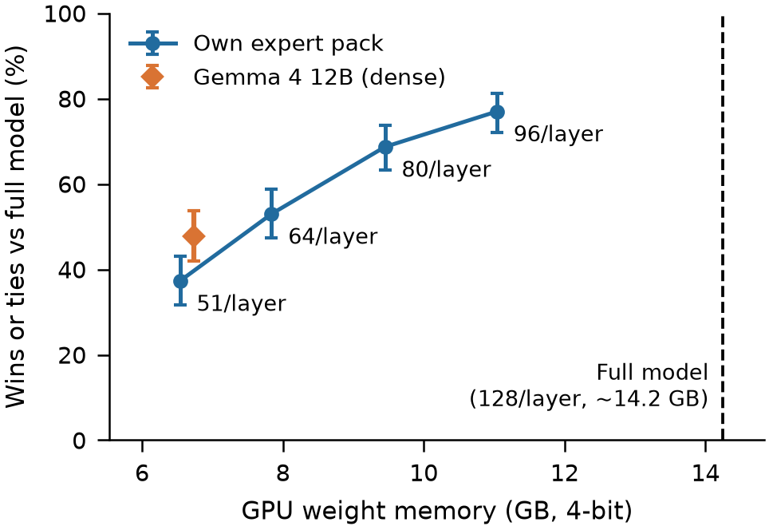

# Edge-MoE: expert packs for a mixture-of-experts model

<p align="center">

</p>

**A narrow-purpose expert pack cut from a big mixture-of-experts model beats the dense model that fits the same mid-range machine, and runs faster.**

Gemma 4 26B-A4B needs about 14 GB for its weights. On a machine with roughly 8–13 GB to give a model, the usual choice is the best dense model that fits, Gemma 4 12B. Edge-MoE keeps only the experts one subject uses (its *expert pack*) and runs that instead. At 7.8 GB of weights, each subject's pack beats Gemma 4 12B on blind-judged questions in all ten subjects tested, while computing only about 4B parameters per token against the 12B's 12B. Nothing is retrained.

**[Explore the interactive domain maps →](https://toastydoc.github.io/Edge-MoE/viz/domain_maps.html)** Which of the model's 3,840 experts each subject uses, and what keeping only those costs.

## The result

300 questions written from held-out Wikipedia articles, 30 in each of ten subjects (*"In geology, what is Hyaloclastite? Explain it in one paragraph"*). Each subject's questions go to that subject's own pack. Gemini 3.1 Pro judged every pair blind, in both orders; a win counts only when both orders agree.

| Head-to-head | Weights in memory | First wins | Ties | Second wins | First wins or ties (95% interval) |
|---|---|---|---|---|---|
| **26B expert pack, 64 experts per layer vs Gemma 4 12B** | 7.8 vs 6.7 GB | **105** | 117 | 78 | **74%** [69%, 79%] |
| 26B expert pack, 51 experts per layer vs Gemma 4 12B | ~6.5 vs 6.7 GB | 70 | 92 | **138** | 54% [48%, 59%] |
| Gemma 4 12B vs the full 26B | 6.7 vs ~14.2 GB | 31 | 112 | 157 | 48% [42%, 53%] |

- **From 7.8 GB the pack is the better answerer.** It beats the 12B 105 to 78 and leads or ties it in every subject (narrowest: economics 7–8, philosophy 7–7).
- **Below that it is not.** At about the 12B's own size (51 experts per layer) the 12B wins twice as often as it loses. The window opens about 1 GB above the 12B's own size.
- **It is faster.** A pack computes about 4B active parameters per token; the 12B computes all 12B. In the prototype that was 5.1 against 3.2 tokens per second at the same memory.



**Quality climbs steadily with the pack.** Against the full 26B, a subject's pack wins or ties 37% of answers at 51 experts per layer, 53% at 64, 69% at 80 and 77% at 96 (11 GB). The 12B sits at 48%, between the 51 and 64 packs.

*On a real runtime: a size-matched comparison in stock llama.cpp (pack Q3_K_M 7.37 GB against 12B Q4_K_M 7.38 GB, and pack Q4_K_M 9.21 GB against 12B Q6_K 9.79 GB) is running; results go here.*

## When to use a pack

| You have, for the model | Use |
|---|---|
| Under about 6 GB | A small dense model (Gemma 4 E4B). A pack this small loses too much. |
| **About 8–13 GB, one narrow job** | **An expert pack** of the big MoE. |
| 14 GB or more | The full model. |
| A small GPU but plenty of system RAM | Expert offloading (llama.cpp, LM Studio, Ollama): full quality, but the whole model must sit in RAM. |

A pack shrinks everything: GPU memory, system RAM and download size. Offloading only moves weights between them.

## How it works

1. **Routing fingerprint.** Run a subject's text through the model and count which experts the router picks in each of the 30 layers. Each subject has a stable fingerprint: packs chosen from two halves of a subject's text share 86% of their experts, against 50% with other subjects' packs.
2. **Shared core plus expert pack.** Keep everything that is not an expert (attention, embeddings, routers), the experts general text uses most, and the subject's most used experts on top, up to a budget of N experts per layer.
3. **Slice the routers to match.** The router takes a softmax over all experts, keeps the top 8 and renormalises them, so dropping the rows of experts that are not kept gives exactly the same choices and weights as masking them. The result is a valid, smaller Gemma 4 model that stock tools load.

Choosing by fingerprint is what makes it work: at 51 experts per layer, a subject's own pack recovers 86% of the loss gap to the full model, while the same number of random experts recovers 49%.

## Try it

Export a pack as a standalone checkpoint, convert it with llama.cpp's own converter and run it in stock llama.cpp (b12549, unmodified):

```bash
python scripts/export_pack_checkpoint.py --domain regulation --budget 64 --check
```

```bash
python convert_hf_to_gguf.py exports/gemma4-26b-regulation-64e --outtype bf16
```

```bash
llama-quantize exports/gemma4-26b-regulation-64e-bf16.gguf exports/gemma4-26b-regulation-64e-Q4_K_M.gguf Q4_K_M
```

```bash
llama-cli -m exports/gemma4-26b-regulation-64e-Q4_K_M.gguf --jinja
```

`--check` confirms identical expert choices on all 30 layers before writing. The model's own chat template (`--jinja`) is required. The 64-per-layer regulation pack is 9.2 GB at Q4_K_M and runs at 202 tokens per second on an RTX 5080 and 19 tokens per second on a Ryzen 7 9700X with no GPU. Its file is larger than the prototype's 7.8 GB because the expert down-projections (704 wide, not a multiple of 256) fall back to a less compact quantisation type; Q3_K_M brings it to 7.37 GB.

## Supporting evidence

<details>
<summary><b>Routing fingerprints and loss: choosing experts by subject beats choosing at random</b></summary>

Ten subjects from Wikipedia article introductions (art, history, biology, geology, politics, computer science, economics, chemistry, physics, philosophy), split by article into profiling and held-out test sets.


Extra loss over the full model on held-out text, nats per token, all at 51 experts per layer, averaged over the ten subjects: shared core alone +1.11, shared core plus 25 random experts +0.56, **own pack +0.15**, best other subject's pack +0.21. Related subjects swap well (chemistry's pack serves biology almost as well as biology's). Per-subject tables, the break-even curve for one pack shared by several subjects, and the token-type analysis are in the [lab notebook](docs/EXPERIMENTS.md).

</details>

<details>
<summary><b>Real tasks: 122 held-out eCFR regulation tasks at 8 GB</b></summary>

Extract (list the authorities a section cites), cite (fill a value and cite its section) and reconcile (which of two dated versions applies). A regulation pack built from non-test CFR titles:

| At 8 GB | Extract F1 | Cite value / right section | Reconcile | Decode (prototype) |
|---|---|---|---|---|
| Gemma 4 12B | .59 | .98 / .90 | **1.00** | 3.2 tok/s |
| 26B regulation pack, 51 per layer | .57 | 1.00 / **.98** | .73 | 5.1 tok/s |

The pack matches the 12B on extraction, cites the right section more often, and loses on reconcile, where it tends to pick the second of two printed versions. These ran at 51 experts per layer, below the window where the pack wins on general questions. Full tables, including offloading and mixed packs, are in the [lab notebook](docs/EXPERIMENTS.md).

</details>

<details>
<summary><b>MMLU, 200 questions per subject</b></summary>

| Option | Memory | law | math |
|---|---|---|---|
| 26B shared core + 40% law pack | 7.1 GB | .655 | .305 |
| 26B shared core + 40% math pack | 7.1 GB | .605 | .590 |
| 26B shared core + full expert pack | 8.5 GB | .705–.750 | .680–.700 |
| Full 26B | 14.9 GB | .775 | .660 |
| Gemma 4 12B | 7.5 GB | .730 | .565 |

With its full pack at 8.5 GB the 26B matches the 12B on law and leads it by 11–14 points on math. A pack is weak outside its subject.

</details>

## Limitations

- **Narrow means narrow.** A pack is much weaker outside its subject, and it drops some long-tail facts even inside it: most of its losses to the full model are factual errors, not fluency.
- **One model so far.** Gemma 4 26B-A4B is the only model tested; the method should apply to any MoE with many fine-grained experts.
- **One judge.** Answer quality is judged by Gemini 3.1 Pro on 300 encyclopedic questions; agreement between the judge's two orders was 78–92%.
- **Prototype numbers.** The head-to-head above used this project's own 4-bit PyTorch prototype (round-to-nearest, groups of 32) for both models. Its speeds compare models with each other; llama.cpp runs about 40× faster in absolute terms.
- **Memory** is the weights held in memory, before activations and context.

## Prior work

Expert pruning without retraining: Lu et al., "Not All Experts are Equal: Efficient Expert Pruning and Skipping for Mixture-of-Experts Large Language Models" (ACL 2024), and work on task-specific expert pruning. This project adds the comparison that decides whether it is worth doing (against the dense model that fits the same machine) and exports packs as standard checkpoints that stock runtimes load.

## Reproducing

Python 3.12 and CUDA 12.8, then `pip install -r requirements.txt`. Gemma models are gated on Hugging Face: accept the licence and run `hf auth login` first. Model weights are not in this repository.

| Step | Script |
|---|---|
| Profile expert use per subject | `scripts/build_wiki_domains.py`, `scripts/profile_domain.py` |
| Choose shared core and packs | `scripts/build_expert_packs.py`, `scripts/build_small_packs.py` |
| Write 4-bit pack files (prototype) | `scripts/quant_packs.py` |
| Blind-judged answers | `scripts/gen_judge_answers.py`, then `scripts/judge_answers.py` with `GEMINI_API_KEY` set |
| Pack-size curve | `scripts/run_pack_sizes.ps1` |
| Head-to-head against Gemma 4 12B | `scripts/run_vs_12b.ps1` |
| Same on llama.cpp, size-matched | `scripts/run_llamacpp_vs_12b.ps1` (`scripts/gen_llamacpp_answers.py`) |
| Pack as a standalone checkpoint | `scripts/export_pack_checkpoint.py` |
| Figures | `scripts/make_paper_figures.py` |
| Domain maps | `scripts/export_domain_maps.py` (template in `viz/`) |

Every other experiment (MMLU, eCFR tasks, offloading, shared packs, pack selectors) and its scripts are listed in the [lab notebook](docs/EXPERIMENTS.md). The repository includes the expert-usage profiles, pack manifests, test sets and every result with per-question outputs (`results/`).

Data sources: MMLU (MIT licence), the eCFR (US federal regulations, public domain), and Wikipedia article introductions (`data/test/wiki_*.jsonl`, CC BY-SA 4.0, © Wikipedia contributors; each row names its article). Model weights are subject to the [Gemma terms of use](https://ai.google.dev/gemma/terms); none are redistributed here.
