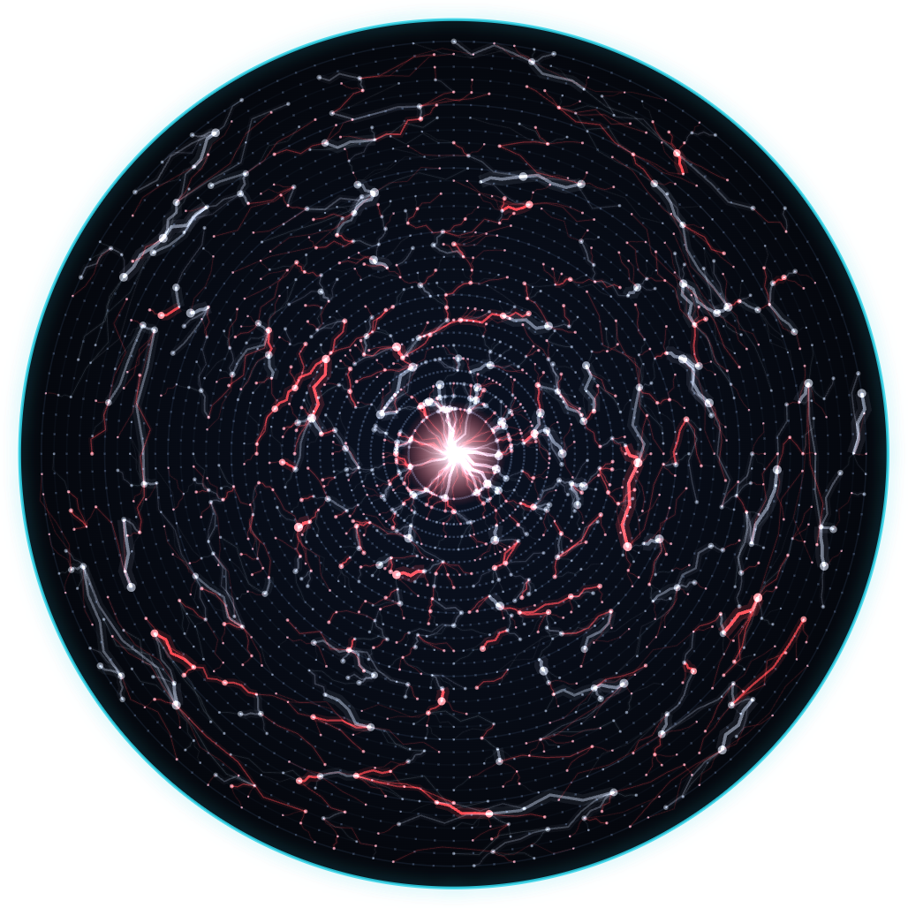

# Edge-MoE: expert packs for a mixture-of-experts model

<p align="center">

</p>

**Map which experts a subject's text is routed to, and you can cut a big mixture-of-experts model down to a smaller, subject-focused model with no retraining and no LoRA. The same map draws each subject's routing fingerprint inside the model, and shows where subjects overlap.**

Edge-MoE does this for Gemma 4 26B-A4B (30 layers × 128 experts). The model it produces keeps its routers, drops the experts its subject doesn't use, and runs in stock llama.cpp in about half the memory, without offloading.

**[Explore the interactive domain maps →](https://toastydoc.github.io/Edge-MoE/viz/domain_maps.html)**

## 1. A subject-focused model, without retraining

1. **Map.** Run a subject's text through the model and count which experts the router picks in each of the 30 layers.
2. **Keep the shared core plus the subject's experts.** Everything that is not an expert (attention, embeddings, routers), the experts general text uses most, and the subject's most used experts on top, up to N of 128 per layer. This set is the subject's *expert pack*.
3. **Slice the routers to match.** The router takes a softmax over all experts, keeps the top 8 and renormalises them, so dropping the rows of experts that are not kept gives exactly the same choices and weights as masking them. The export script checks this on all 30 layers before writing.

The result is an ordinary Gemma 4 checkpoint with fewer experts per layer. llama.cpp's own converter turns it into a GGUF, and stock llama.cpp (b12549, unmodified) runs it:

| Model | Experts per layer | File (GGUF) | RTX 5080 | Ryzen 7 9700X, no GPU |
|---|---|---|---|---|
| Full Gemma 4 26B-A4B, Q4_K_M | 128 | 16.8 GB | — | — |
| Full model, Q3_K_M | 128 | 13.3 GB | 223 tok/s | 20.0 tok/s |
| Full model, Q2_K | 128 | 10.6 GB | degenerate output on all 300 test questions | |
| **Subject pack, Q4_K_M** | 64 | **9.2 GB** | 200 tok/s | 17.5 tok/s |
| **Subject pack, Q3_K_M** | 64 | **7.4 GB** | 225 tok/s | 20.5 tok/s |

Squeezing the full model to 10.6 GB with standard quantisation breaks it; dropping half the experts and keeping the routers gives a working model at 7.4 GB.

**Not offloading.** Offloading keeps every expert and moves the ones the GPU can't hold into system RAM: full quality, but the whole model still has to fit in RAM and on disk. A pack removes the experts its subject doesn't use, so GPU memory, RAM and download all shrink.

**What it costs.** A pack answers its own subject well and other subjects poorly. Against the full 26B on 300 blind-judged questions from held-out Wikipedia articles (each subject's questions to that subject's pack; Gemini 3.1 Pro judging both orders, a win only when both agree), a pack wins or ties 37% of answers at 51 experts per layer, 53% at 64, 69% at 80 and 77% at 96. Most of its losses are long-tail facts it dropped, not fluency.

**The map is what makes it work.** At 51 experts per layer, a subject's own pack recovers 86% of the gap in prediction loss between the shared core alone and the full model; the same number of randomly chosen experts recovers 49%.

## 2. Every subject has a routing fingerprint

Ten subjects were built from Wikipedia article introductions (art, history, biology, geology, politics, computer science, economics, chemistry, physics, philosophy), one source for all ten so the comparison is about topic, not writing style. Each subject's map is its *routing fingerprint*: which experts its text reaches in every layer.


*Each map: router at the centre, the 30 layers as rings, every ring's 128 experts in evenly spaced slots placed by which subjects favour them. Coloured: the subject's 25-expert pack per layer; grey: the shared core. Line weight and dot size follow the expert's share of that layer's routing.*

- **Fingerprints are stable.** The pack chosen from one half of a subject's articles shares 86% of its experts with the pack chosen from the other half, against 50% with other subjects' packs.
- **Some subjects stand apart.** Computer science is the most distinct (41% overlap with the rest).
- **Others overlap into neighbourhoods.** Related subjects share experts: chemistry's pack serves biology almost as well as biology's own, and two related subjects can share one pack at almost no cost.

**[The interactive maps](https://toastydoc.github.io/Edge-MoE/viz/domain_maps.html)** draw all fifteen mapped subjects this way. Switch between the full model (every expert a subject reaches) and its pack, select up to three subjects to see where they overlap, and hover an expert to see its routing share and the tokens it receives.

## Try it

Export a pack as a standalone checkpoint, convert it with llama.cpp's own converter and run it in stock llama.cpp (b12549, unmodified):

```bash
python scripts/export_pack_checkpoint.py --domain regulation --budget 64 --check
```

```bash
python convert_hf_to_gguf.py exports/gemma4-26b-regulation-64e --outtype bf16
```

```bash
llama-quantize exports/gemma4-26b-regulation-64e-bf16.gguf exports/gemma4-26b-regulation-64e-Q4_K_M.gguf Q4_K_M
```

```bash
llama-cli -m exports/gemma4-26b-regulation-64e-Q4_K_M.gguf --jinja
```

`--check` confirms identical expert choices on all 30 layers before writing. The model's own chat template (`--jinja`) is required. The 64-per-layer regulation pack is 9.2 GB at Q4_K_M and runs at 202 tokens per second on an RTX 5080 and 19 tokens per second on a Ryzen 7 9700X with no GPU. Some expert down-projections (704 wide, not a multiple of 256) fall back to a less compact quantisation type; Q3_K_M brings the file to 7.37 GB.

## Limitations

- **Narrow means narrow.** A pack is much weaker outside its subject, and it drops some long-tail facts even inside it.
- **Not a better small model.** At the same file size on llama.cpp, the dense Gemma 4 12B answers general questions somewhat better than a pack (114 to 69 at 7.4 GB); a pack generates 2–3× faster. Full comparison in the [lab notebook](docs/EXPERIMENTS.md#against-gemma-4-12b-the-dense-model-of-about-the-same-size).
- **One model so far.** Gemma 4 26B-A4B is the only model tested; the method should apply to any MoE with many fine-grained experts.
- **One judge.** Answer quality is judged by Gemini 3.1 Pro on 300 encyclopedic questions; agreement between the judge's two orders was 78–92%.

## Prior work

Expert pruning without retraining: Lu et al., "Not All Experts are Equal: Efficient Expert Pruning and Skipping for Mixture-of-Experts Large Language Models" (ACL 2024), and work on task-specific expert pruning. This project chooses experts by each subject's routing fingerprint, maps those fingerprints, and exports packs with sliced routers as standard checkpoints that stock runtimes load.

## Reproducing

Python 3.12 and CUDA 12.8, then `pip install -r requirements.txt`. Gemma models are gated on Hugging Face: accept the licence and run `hf auth login` first. Model weights are not in this repository.

| Step | Script |
|---|---|
| Profile expert use per subject | `scripts/build_wiki_domains.py`, `scripts/profile_domain.py` |
| Choose shared core and packs | `scripts/build_expert_packs.py`, `scripts/build_small_packs.py` |
| Write 4-bit pack files (prototype) | `scripts/quant_packs.py` |
| Blind-judged answers | `scripts/gen_judge_answers.py`, then `scripts/judge_answers.py` with `GEMINI_API_KEY` set |
| Pack-size curve | `scripts/run_pack_sizes.ps1` |
| Pack as a standalone checkpoint | `scripts/export_pack_checkpoint.py` |
| Figures | `scripts/make_paper_figures.py` |
| Domain maps | `scripts/export_domain_maps.py` (template in `viz/`) |

Every other experiment (per-subject loss tables, shared packs, what the router's choice tracks, comparisons with Gemma 4 12B, MMLU, eCFR tasks, offloading, pack selectors) and its scripts are listed in the [lab notebook](docs/EXPERIMENTS.md). The repository includes the expert-usage profiles, pack manifests, test sets and every result with per-question outputs (`results/`).

Data sources: MMLU (MIT licence), the eCFR (US federal regulations, public domain), and Wikipedia article introductions (`data/test/wiki_*.jsonl`, CC BY-SA 4.0, © Wikipedia contributors; each row names its article). Model weights are subject to the [Gemma terms of use](https://ai.google.dev/gemma/terms); none are redistributed here.
