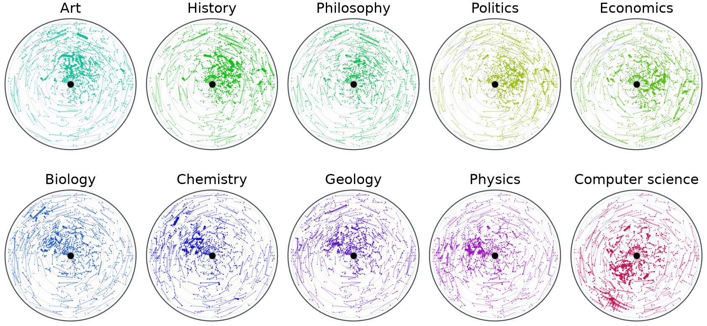
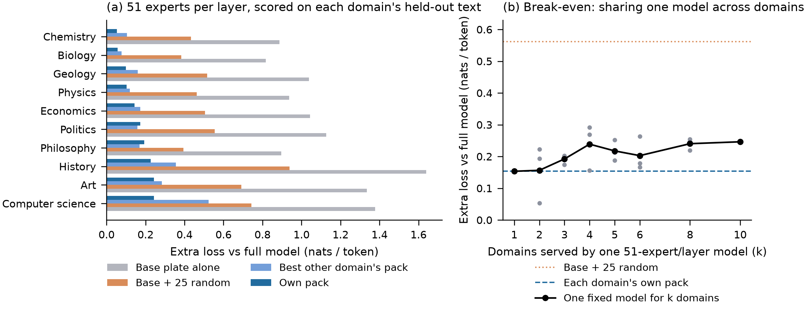
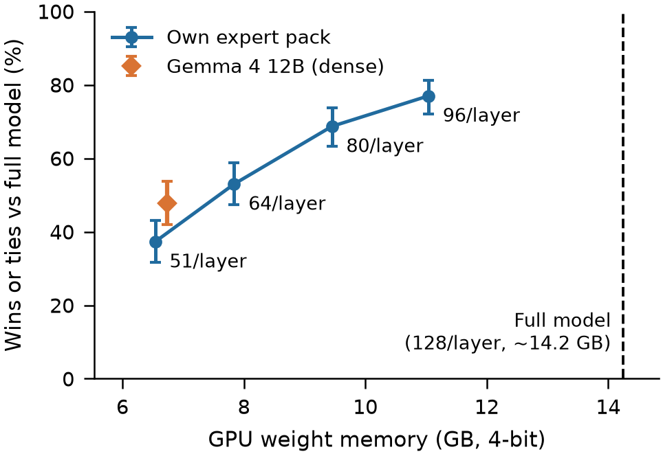

# Edge-MoE lab notebook

Every experiment behind the [README](../README.md), with full tables, in the order they were run. The README carries the main result; this file keeps the detail, side experiments and earlier framings. Image and script paths are relative to the repository root.

## Earlier framing (kept for context)

**Where this fits.** Lowering GPU memory alone is a solved problem: expert offloading (what llama.cpp, LM Studio and Ollama do for MoE models) keeps every expert in system RAM and gives full-model quality on an 8 GB card. What offloading does not shrink is the total footprint: it still needs the whole model in RAM and on disk, which is exactly what the devices above lack. Expert packs shrink all of it (GPU memory, system RAM and download). The project rests on one finding, that a domain's routing fingerprint predicts which experts its text will use, and puts it to work:

1. **On memory-limited devices, expert packs cut the whole footprint at a measured quality cost.** The cost falls steadily as the pack budget grows: against the full model, a domain's own pack wins or ties 37% of blind-judged answers at 51 experts per layer (about 6.5 GB of weights), 53% at 64, 69% at 80 and 77% at 96 (11 GB, against about 14.2 GB for all 128). Results below.
2. **Parked: fingerprint-guided placement on PCs with RAM to spare** (keep the domain's predicted experts in the fastest memory, the rest in slower memory, at full quality). It serves machines outside the use case, so it waits; if revived, the measure is GPU hit rate at a fixed budget against a warm cache, since llama.cpp cannot yet place individual experts.

The finding itself holds: each domain has a stable routing fingerprint, and choosing experts by it beats choosing at random by a wide margin.
**Terms.**

| Term | Meaning |
|---|---|
| **Routing fingerprint** | The measured pattern of which experts the router sends a domain's text to, per layer. |
| **Shared core** | Attention, embeddings, all routers, and the experts general text uses most; installed for every domain. |
| **Expert pack** | A domain's most used experts outside the shared core, loaded on top of it. |
| **Pack budget** | How many experts per layer are installed in total (shared core + pack); 51 of 128 fits 8 GB. |
| **Shared pack** | One pack built for several domains together, within the same budget. |

The method, fingerprint-guided expert selection, is in the literature's terms domain-specific expert pruning without retraining, made reversible and swappable. It is not compression (no weight is changed) and not offloading (experts outside the pack are not reachable while it is loaded).

The model is `google/gemma-4-26B-A4B-it`, which has 30 layers of 128 experts and routes each token to 8 of them. It is split into:

- **Shared core:** attention, embeddings, all routers, plus the experts that general text uses most (10–20% per layer).
- **Expert packs (medicine, law, math, and more below):** the experts that domain uses most and that are not already in the shared core. Packs stack, and an expert shared by two packs is loaded once.
- **Routers restricted to installed experts:** each router picks its top 8 among the experts present. Installing a pack only adds experts.
- **Pack selector ("gate"):** a small logistic regression over the shared core's hidden states. It picks a pack before any pack is loaded. When it fires for a domain with no pack installed, that is a missing-module signal: the device can fetch the pack or defer to an online service.

All weights are 4-bit (symmetric round-to-nearest, groups of 32, bf16 scales), and the dense baselines get exactly the same treatment. The tests ran on an RTX 5080 16 GB with a Ryzen 7 9700X and 32 GB RAM, under Windows 11.

## Results

### MMLU, 200 questions per domain, everything 4-bit (embeddings included)

| Option | Peak VRAM | law | math | Average of 5 domains | Speed |
|---|---|---|---|---|---|
| 26B shared core + 40% law pack | 7.1 GB | .655 | .305 | 49.7 | 3–5 tok/s |
| 26B shared core + 40% math pack | 7.1 GB | .605 | .590 | 60.8 | 3–5 tok/s |
| 26B shared core + full expert pack | 8.5 GB | .705–.750 | .680–.700 | — | 3–5 tok/s |
| 26B shared core + three packs | 10.5 GB | .770 | .645 | 75.0 | about 5 tok/s |
| Full 26B | 14.9 GB | .775 | .660 | 79.3 | — |
| Gemma 4 12B | 7.5 GB | .730 | .565 | 70.3 | 3.2 tok/s |
| Gemma 3 12B | 7.5 GB | .655 | .465 | 67.2 | 3.3 tok/s |
| Gemma 4 E4B | 3.2 GB | .610 | .385 | 59.0 | 7.3 tok/s |

At 8 GB the pack ties Gemma 4 12B on math, trails it by 7.5 points on law, and is much weaker outside its domain. With the full pack at 8.5 GB it matches the 12B on law and leads it by 11–14 points on math. The selectors fire on 88–100% of their own domain's questions.

### Held-out policy tasks at a fixed 8 GB: 122 eCFR tasks

The tasks are 50 extract (list the authorities a section cites), 50 cite (fill a value and cite its section) and 22 reconcile (two dated versions of a rule: which value applies on a date). They are graded automatically. Every 26B configuration at 8 GB keeps exactly **51 of 128 experts per layer** on the GPU and runs on the same 4-bit weights; they differ only in *which* experts are there.

| Configuration (8 GB unless noted) | Extract F1 | Cite value / right section | Reconcile | Peak GPU (in use / reserved) | First token, 2k / 8k | Decode | 32k prompt |
|---|---|---|---|---|---|---|---|
| Gemma 4 12B (dense) | .59 | .98 / .90 | **1.00** | 8.3 / 9.2 GB | 1.4 / 4.5 s | 3.2 tok/s | 25 s |
| Shared core + law pack (from MMLU law) | .39 | 1.00 / .78 | .68 | 7.7 / 8.5 GB | 1.7 / 5.9 s | 5.0 tok/s | 30 s |
| **Shared core + regulation pack** (non-test CFR titles) | .57 | 1.00 / **.98** | .73 | 7.7 / 8.5 GB | 1.7 / 6.0 s | 5.1 tok/s | 30 s |
| Shared core + regulation and math, shared budget | .55 | 1.00 / .98 | .73 | 7.7 / 8.5 GB | 1.6 / 5.8 s | 5.1 tok/s | 27 s |
| Shared core + reconcile pack (version-comparison prompts) | .55 | 1.00 / 1.00 | .82 | 7.7 / 8.5 GB | 1.6 / 5.4 s | 5.5 tok/s | 26 s |
| Shared core + regulation and reconcile, shared budget | .46 | 1.00 / 1.00 | .86 | 7.7 / 8.5 GB | 1.6 / 5.4 s | 5.5 tok/s | 27 s |
| One trimmed model for all five domains | .51 | .98 / .92 | .91 | 7.7 / 8.5 GB | 1.6 / 5.6 s | 5.4 tok/s | 27 s |
| Per-prompt plan (router picks the 51) | .56 | 1.00 / .98 | .73 | 7.7 / 8.4 GB | 3.6 / 7.5 s | 5.5 tok/s | 26 s |
| **Expert offloading** (all 128 reachable from RAM, 51 cached) | **.77** | 1.00 / .98 | **1.00** | 7.7 / 8.5 GB | 3.1 / 11.2 s | 5.4 tok/s | 57 s |
| Shared core + three packs (11 GB, over the limit) | .66 | 1.00 / 1.00 | 1.00 | 11.0 / 11.8 GB | 2.1 / 7.9 s | 5.2 tok/s | 37 s |

Paired comparisons on the same tasks (bootstrap 95% intervals), against the regulation pack:

- **Packs built from the real work matter.** The regulation pack beats the MMLU-law pack by 18 points on extract and 20 on citing the right section, and cites the right section more often than the 12B (.98 vs .90).
- **Adding a second domain cost nothing measurable.** Regulation plus math in the same 51 slots is within noise of regulation alone on all three task types.
- **The 12B wins reconcile** (+27 points, 6 wins and 0 losses). All six pack failures have the same shape: the version printed first governs, and the pack chooses the second one. Configurations that keep more general experts (the trimmed model, offloading, 11 GB) do not show this.
- **Offloading has the best quality at 8 GB.** It is 21 points ahead on extract and 27 on reconcile, and at least as good as the 11 GB model. The cost is the prompt: it copies about 0.85 GB from RAM per prompt token (a third of expert lookups miss the GPU cache), first token takes roughly twice as long, and a 32k prompt takes 57 s instead of 30 s. Decoding speed is unaffected.
- **A reconcile-aware pack narrowed the gap but did not close it.** It was profiled on 1,600 synthetic version-comparison prompts from the non-test titles, each with a worked answer (`scripts/build_reconcile_prompts.py`); the prompts reuse the test's question wording but none of its regulations. Alone it raised reconcile from .73 to .82 at no cost elsewhere; mixed with the regulation pack it reached .86 but lost 11 points on extract. Neither reconcile gain is outside noise (5 wins, 2–3 losses), and every remaining failure is still the same "second version" mistake, so the bias is reduced, not removed. Offloading and the 12B stay at 1.00.
- **Picking experts per prompt did not help.** One base-only router pass (0.5 s) plus a swap (1.5 s, about 190 experts changed) scored the same as the fixed regulation pack.

**Where this leaves the claim.** At 8 GB the packs are 1.6× faster than the 12B at decoding and fit under the limit, which the 12B does not quite. On quality they match the 12B on extract, beat it on citations and lose on reconcile. The decisive alternative turned out to be offloading the full 26B: same memory, equal or better quality on every task type, and only the time to first token is worse. A pack system only wins where first-token latency on long prompts matters more than reconcile-type reasoning.

An earlier 63-task run (law packs only, no limit) is kept in `results/policy_*.json` without the `_tasks_v2` suffix.

### Ten domains from Wikipedia: routing fingerprints, expert packs and the break-even point

Ten more domains (art, history, biology, geology, politics, computer science, economics, chemistry, physics, philosophy) were built from Wikipedia article introductions: five categories per domain, articles found under two domains dropped from both, then split by article into 249–300 profiling articles and 83–100 held-out test articles per domain. One source for all ten keeps the comparison about topic, not writing style.

**Each domain has a stable routing fingerprint.** A pack chosen from one half of a domain's profiling articles shares 86% of its experts (Jaccard) with the pack chosen from the other half, against 50% with other domains' packs. Computer science is the most distinct (41% overlap with the rest).

*Each map: router at the centre, the 30 layers as rings, every ring's 128 experts in evenly spaced slots placed by which domains favour them. Coloured: the domain's 25-expert pack per layer; grey: the shared core. Line weight and dot size follow the expert's share of that layer's routing.*

**Packs recover most of what trimming loses, and choosing the experts is what does it.** Loss is next-token cross-entropy on the held-out introductions, scored as the model's reply to *"Write the Wikipedia introduction for the article <title>"* (Gemma 4 instruct degenerates on bare text outside a chat turn). Extra loss over the full 128-expert model, nats per token, all at 51 experts per layer:

| Domain | Full model | Shared core alone | Shared core + 25 random | **Own pack** | Best other pack |
|---|---|---|---|---|---|
| art | 3.37 | +1.33 | +0.69 | **+0.24** | history +0.29 |
| history | 3.05 | +1.64 | +0.94 | **+0.23** | art +0.36 |
| biology | 3.15 | +0.82 | +0.38 | **+0.06** | chemistry +0.08 |
| geology | 3.18 | +1.04 | +0.52 | **+0.10** | biology +0.16 |
| politics | 3.21 | +1.13 | +0.55 | +0.17 | **history +0.16** |
| computer science | 3.18 | +1.38 | +0.74 | **+0.24** | physics +0.52 |
| economics | 3.14 | +1.04 | +0.51 | **+0.14** | politics +0.17 |
| chemistry | 3.06 | +0.89 | +0.43 | **+0.05** | geology +0.11 |
| physics | 2.96 | +0.94 | +0.46 | **+0.10** | chemistry +0.12 |
| philosophy | 3.29 | +0.90 | +0.40 | +0.19 | **history +0.17** |
| **mean** | 3.16 | +1.11 | +0.56 | **+0.15** | +0.21 |

The own pack recovers 86% of the gap between the shared core and the full model; random experts recover 49%. The remaining +0.15 nats is about 16% higher perplexity than the full model. Packs act more like neighbourhoods than single subjects: related domains swap well (chemistry's pack serves biology almost as well as biology's), and the history pack beat the politics and philosophy packs on their own text.

**Break-even: one shared pack for k domains.** Shared core plus the experts k domains use most, still 51 per layer, scored on its own k domains (3 random domain sets per k, 1 for k = 10):

| Domains served | 1 (own pack) | 2 | 3 | 4 | 5 | 6 | 8 | 10 |
|---|---|---|---|---|---|---|---|---|
| Extra loss (nats/token) | +0.153 | +0.156 | +0.192 | +0.239 | +0.218 | +0.203 | +0.240 | +0.246 |
| Share of the pack's gain over random kept | 100% | 99% | 91% | 79% | 84% | 88% | 79% | 77% |

Two domains share 51 slots at no measurable cost. From four on, the curve levels off near 80% instead of falling toward random: one shared pack for all ten keeps about three quarters of a dedicated pack's gain. Swapping per domain is worth about 0.09 nats per token over that. The bumps between k = 4 and 6 are within the spread of the three sets.

**What the router's choice tracks.** A token pass (`scripts/profile_expert_tokens.py`, 900 prompts over all 15 domains) recorded which tokens each expert receives. In layers 1–2 and again in the last three layers, token type (numbers, punctuation, word starts) explains more of the choice of expert than the domain does; in layers 3–27 the domain explains more (mean share of expert-choice entropy: domain 5.6 / 6.3 / 5.1% in layers 1–10 / 11–20 / 21–30, token type 4.2 / 1.9 / 2.4%). Neither explains most of it. The two measures have different numbers of categories (15 and 6), so they are not directly comparable without a shuffled baseline.

**Domain maps** ([open the interactive maps](https://toastydoc.github.io/Edge-MoE/viz/domain_maps.html), also on [Claude.ai](https://claude.ai/artifact/RCQaEJswZb8Pbj3Q5oPtYM); source `viz/domain_maps.html`) draw each domain's experts as a radial map: the router at the centre, the 30 layers as rings, each ring's 128 experts in numbered slots (optionally grouped by domain preference, the layout used in the figure above), the shared core in white and the pack in the domain's colour. Switch between the full model (every expert the domain's text reaches) and the 8 GB expert pack, select up to three domains to see them share one pack, and read the trade-off beside the map: GPU memory −48% (7.7 GB vs 14.9 GB), experts on the GPU −60%, and the measured quality cost for that selection. Hovering an expert shows its routing share and the tokens it receives. The bolts between layers are drawn for legibility; the router does not pass tokens from one specific expert to another.

**Blind-judged answers: the quality cost is not negligible.** Loss measures surprise at real text, not answer quality, so 300 questions written from the held-out articles (30 per domain, *"In geology, what is Hyaloclastite? Explain it in one paragraph"*, `results/judge/questions.jsonl`) were answered greedily by the full model, each domain's own pack, and one shared pack for all ten, all at the same 4-bit weights. Gemini 3.1 Pro judged each pair blind, in both orders; a win counts only when both orders agree (they agreed on 87–92%).

| Against the full model | Pack wins | Ties | Full model wins | Pack wins or ties (95% interval) |
|---|---|---|---|---|
| Each domain's own expert pack | 22 | 90 | 188 | **37%** [32%, 43%] |
| One shared pack for all ten domains | 13 | 72 | 215 | **28%** [23%, 33%] |

By domain the own pack ranges from 20% (politics) to 50% (philosophy). Two things go wrong:

- **Lost facts (most losses).** In 129 of the 188 own-pack losses the judge cites a factual error or a misidentified term, e.g. the history pack saying L. Ron Hubbard had no military career, or a pack claiming "cameo" carving does not exist. Long-tail facts appear to live in experts that a domain's prose rarely routes to, so the pack drops them even within its own domain. Prose loss barely registers this: the pack is fluent, just wrong.
- **Repetition loops.** 23 own-pack and 42 shared answers degenerate into repeated tokens (`* * *`, `| | |`), against almost none for the full model; packs built from Wikipedia prose appear to miss experts for lists and tables. Removing every looped answer only moves the own pack from 37% to 39% win-or-tie, so loops are not the main cost.

This revises the claim above. On these questions an 8 GB expert pack is a clearly weaker answerer than the full 26B, and the 86% recovery measured by loss overstates answer quality. The loss results still show that choosing experts by domain beats random choice by a wide margin; what they do not show is that the remaining gap is small to a reader. Raw verdicts with the judge's reasons: `results/judge/verdicts_*.jsonl`.

**Pack size: how much budget buys the quality back.** The same 300 questions, answered by each domain's own pack at larger budgets (shared core unchanged, more of the domain's experts on top) and judged the same way against the full model:

| Experts per layer | GPU weight memory | Pack wins | Ties | Full model wins | Pack wins or ties (95% interval) |
|---|---|---|---|---|---|
| 51 | ~6.5 GB* | 22 | 90 | 188 | **37%** [32%, 43%] |
| 64 | 7.8 GB | 37 | 122 | 141 | **53%** [47%, 59%] |
| 80 | 9.5 GB | 53 | 153 | 94 | **69%** [63%, 74%] |
| 96 | 11.0 GB | 60 | 171 | 69 | **77%** [72%, 81%] |
| 128 (full model) | ~14.2 GB* | | | | (reference) |

\*Weight memory (4-bit weights resident on the GPU, before activations) was measured at 64, 80 and 96; every expert is the same size (0.10 GB per expert per layer across 30 layers), so 51 and 128 lie on the same line. The judge's two orders agreed on 78–84% of questions. Answers running to the 320-token limit, mostly repetition loops, fall from 37 at 51 per layer to 9, 3 and none at 96. Going from 51 to 96 experts per layer adds 4.5 GB and cuts the full model's wins from 188 to 69; at 96 per layer a domain's pack holds 75% of the experts and 77% of its answers are as good as or better than the full model's, so most of the quality returns well before the whole model does. `results/pack_size_summary.json`, `scripts/run_pack_sizes.ps1`.

**Against the model that already fits: Gemma 4 12B.** On a device that cannot hold the 26B, the real choice is between a pack and the best dense model of the same size. Gemma 4 12B, 4-bit the same way, holds 6.74 GB of weights on the GPU, about the same as the 51-per-layer pack (~6.5 GB). It answered the same 300 questions, judged the same way:

| Head-to-head | GPU weights | First wins | Ties | Second wins | First wins or ties (95% interval) |
|---|---|---|---|---|---|
| Own pack, 51/layer vs Gemma 4 12B | ~6.5 vs 6.7 GB | 70 | 92 | **138** | 54% [48%, 59%] |
| Own pack, 64/layer vs Gemma 4 12B | 7.8 vs 6.7 GB | **105** | 117 | 78 | **74%** [69%, 79%] |
| Gemma 4 12B vs full 26B | 6.7 vs ~14.2 GB | 31 | 112 | 157 | 48% [42%, 53%] |

- **At equal memory the 12B is the better answerer.** Against the 51-per-layer pack it wins twice as often as it loses (138 to 70).
- **About 1.1 GB more turns it around.** The 64-per-layer pack beats the 12B 105 to 78, and leads or ties in all ten domains (narrowest: economics 7–8, philosophy 7–7). On the curve above the 12B sits between the two pack sizes (48% against the full model, vs 37% and 53%).
- **The pack is also the faster model.** It computes about 4B active parameters per token against the 12B's 12B; in this prototype that was 5.1 vs 3.2 tokens per second at 8 GB (policy table above).

So for this use case the pack is not a free win at the smallest size, but there is a real window: from roughly 7.8 GB of weights, a 26B expert pack answers in-domain questions better and faster than the dense model that fits the same device. Verdicts: `results/judge/verdicts_*gemma4_12b*.jsonl`; `scripts/run_vs_12b.ps1`.

**On a real runtime: a pack as a standalone GGUF.** A pack is a valid, smaller Gemma 4 MoE: each layer keeps its N experts, and each router keeps only their rows (and their per-expert scales). Because the router renormalises its top 8 after the softmax, dropping the rows of experts that can never be chosen gives exactly the same choices and weights as masking them; `scripts/export_pack_checkpoint.py --check` confirms identical expert choices on all 30 layers (largest weight difference 9e-8). The first export is the regulation pack at 64 of 128 experts per layer, converted with llama.cpp's own `convert_hf_to_gguf.py` and quantised to Q4_K_M (llama.cpp b12549, unmodified):

| `gemma4-26b-regulation-64e-Q4_K_M.gguf` | |
|---|---|
| File size | 8.56 GiB (9.2 GB); 13.8B parameters, about 4B active per token |
| RTX 5080, all layers on the GPU | 10,600 tok/s prompt, **202 tok/s** generation |
| Ryzen 7 9700X, CPU only, 8 threads | 135 tok/s prompt, **19 tok/s** generation |

It loads and runs in stock llama.cpp with no patches and answers in-domain questions coherently. Two notes: the file is larger than the prototype's 7.8 GB because the expert down-projections (704 wide, not a multiple of 256) fall back to a less compact quantisation type, and llama.cpp's tokens per second are 40× the PyTorch prototype's, so the prototype speeds elsewhere in this README compare configurations with each other, not with a real runtime.

### Against Gemma 4 12B, the dense model of about the same size

Same 300 Wikipedia questions, same blind judge (Gemini 3.1 Pro, both orders, a win only when both agree).

**Prototype** (this project's 4-bit PyTorch prototype, round-to-nearest in groups of 32, for both models):

| Head-to-head | Weights in memory | First wins | Ties | Second wins |
|---|---|---|---|---|
| Pack, 64 experts per layer vs Gemma 4 12B | 7.8 vs 6.7 GB | **105** | 117 | 78 |
| Pack, 51 experts per layer vs Gemma 4 12B | ~6.5 vs 6.7 GB | 70 | 92 | **138** |
| Gemma 4 12B vs the full 26B | 6.7 vs ~14.2 GB | 31 | 112 | **157** |

**Stock llama.cpp b12549, matched on file size.** The prototype's 64-per-layer lead did not survive real quantisation:

| Head-to-head | File sizes | First wins | Ties | Second wins |
|---|---|---|---|---|
| Pack 64/layer Q3_K_M vs 12B Q4_K_M | 7.37 vs 7.38 GB | 69 | 117 | **114** |
| Pack 64/layer Q4_K_M vs 12B Q6_K | 9.21 vs 9.79 GB | 71 | 124 | **105** |
| Pack 96/layer Q4_K_M vs 12B Q8_0 (7 of 10 subjects, 210 questions) | 13.0 vs 12.67 GB | **83** | 98 | 29 |
| Full 26B Q3_K_M vs 12B Q8_0 | 13.29 vs 12.67 GB | **112** | 137 | 51 |

Both GGUF files beat their own prototype versions (pack 89–151–60, 12B 112–141–47), the 12B by more: round-to-nearest 4-bit hurt the dense model more than the MoE. So at equal file size from 7 to 10 GB the 12B answers somewhat better. The full 26B at Q2_K (10.58 GB) produced degenerate output on all 300 questions. Generation speed (llama-bench, tokens per second):

| Model | File | RTX 5080 | Ryzen 7 9700X, CPU only |
|---|---|---|---|
| Pack 64/layer Q3_K_M | 7.37 GB | 225 | 20.5 |
| 12B Q4_K_M | 7.38 GB | 98 | 6.6 |
| Pack 64/layer Q4_K_M | 9.21 GB | 200 | 17.5 |
| 12B Q6_K | 9.79 GB | 78 | 5.0 |
| Pack 96/layer Q4_K_M | 13.0 GB | 187 | 17.7 |
| Full 26B Q3_K_M | 13.29 GB | 223 | 20.0 |
| 12B Q8_0 | 12.67 GB | 62 | 3.9 |

Scripts: `scripts/run_vs_12b.ps1` (prototype), `scripts/run_llamacpp_vs_12b.ps1` and `scripts/run_llamacpp_bigger.ps1` (llama.cpp, answers via `scripts/gen_llamacpp_answers.py`). Raw speed output: `results/llamacpp_speed.txt`.

## Caveats

- **Small samples:** 200 questions per domain is about ±3 points. There are 22 reconcile tasks, so each is worth 4.5 points; differences of one or two tasks are noise.
- **Plain rounding:** round-to-nearest 4-bit hurts dense models more than the MoE; E4B lost 7 points. GPTQ, AWQ or Q4_K_M would be a fairer comparison.
- **Speed:** speeds come from a plain-PyTorch prototype that unpacks the 4-bit weights on every step. They compare the models with each other, not with what a real runtime would reach.
- **Load times:** the 26B loads from pre-quantised pack files, while the dense models are quantised as they load.
- **Memory:** "8 GB" means peak memory in use by PyTorch; the allocator reserves 0.7–0.9 GB more. Gemma 4 12B peaks at 8.3 GB, slightly over the limit.
- **Long prompts:** the earlier slow 32k prompts (91–152 s) were allocator fragmentation spilling into system RAM; freeing the cache after each prefill chunk fixed it (now 25–37 s, 57 s with offloading).
- **Offloading uses this prototype's own LRU cache** with pinned RAM, preloaded with the trimmed model's experts. A production offloading runtime would prefetch and could be faster; llama.cpp was not tested.
- **Reconcile tasks** come only from yearly penalty and threshold updates where a value sits in the paragraph text.
- **The ten Wikipedia domains** measure loss on encyclopedic prose, not task performance. The loss sweep scored 8 texts at a time, which needs up to 11.2 GB of working memory; the experts installed are the same 51 per layer as at 8 GB. The full-model reference runs through the offloading path, which computes the same output without holding all experts at once.

## All scripts

Use Python 3.12 and CUDA 12.8 (RTX 50-series), then `pip install -r requirements.txt` (see that file for the torch index). Gemma models are gated on Hugging Face: accept the licence and run `hf auth login` first. Pack files and model weights are not in this repository; the scripts rebuild them (about 73 GB under `quant/`).

| Step | Script |
|---|---|
| Build prompt sets and test sets | `scripts/build_datasets.py`, `scripts/build_base_prompts.py` |
| Profile expert use per domain | `scripts/profile_domain.py` |
| Choose shared core and packs | `scripts/build_expert_packs.py`, `scripts/build_small_packs.py` |
| Train pack selectors | `scripts/train_expert_gates.py` |
| Write 4-bit pack files | `scripts/quant_packs.py` |
| Score the 26B from packs on MMLU | `scripts/eval_quant.py --quant-dense --quant-embed` |
| Score the dense baselines | `scripts/eval_dense_quant.py --quant-embed` |
| Build the eCFR policy tasks | `scripts/build_policy_tasks.py` |
| Profile the regulation and reconcile packs | `scripts/build_reg_prompts.py`, `scripts/build_reconcile_prompts.py`, then `scripts/profile_domain.py` |
| Run the policy tasks | `scripts/eval_policy.py --config ...` |
| The 8 GB comparison | `scripts/run_8gb_comparison.ps1` (`edge_moe/expert_store.py` holds all configurations) |
| Ten Wikipedia domains: data, profiles, loss sweep | `scripts/build_wiki_domains.py`, then `scripts/run_domains.ps1` (`scripts/eval_domain_loss.py`) |
| Expert token pass | `scripts/profile_expert_tokens.py` |
| Analysis tables | `scripts/analyze_domains.py` |
| Domain maps | `scripts/export_domain_maps.py` (template in `viz/`) |
| Paper figures (PDF, SVG, 300 dpi PNG) | `scripts/make_paper_figures.py` → `figures/` |
| Blind-judged answers | `scripts/gen_judge_answers.py`, then `scripts/judge_answers.py` with `GEMINI_API_KEY` set |
| Pack-size curve (64, 80, 96 per layer) | `scripts/run_pack_sizes.ps1` (`gen_judge_answers.py --budget N`), then `scripts/make_paper_figures.py` |
| Head-to-head against Gemma 4 12B | `scripts/run_vs_12b.ps1` (`gen_judge_answers.py --configs gemma4_12b`) |
| Pack as a standalone GGUF | `scripts/export_pack_checkpoint.py --domain regulation --budget 64 --check`, then llama.cpp `convert_hf_to_gguf.py <export dir> --outtype bf16` and `llama-quantize ... Q4_K_M` |

The repository includes the expert-usage profiles (`profiles*/`), the pack manifests and selectors (`expert_packs/`), the test sets (`data/test/`, `data/policy/tasks*.jsonl`) and every result with per-question outputs (`results/`). The `train_*` and `distill` scripts are earlier experiments with trained packs; the packaging approach above does not use them.
